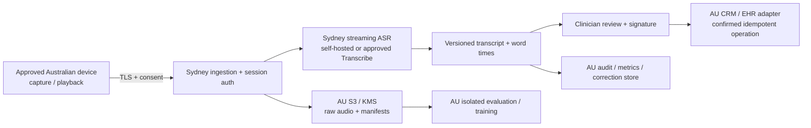

# Australian processing, access and system boundaries

## Australian AWS boundary

The project requirement is stricter than a generic privacy certification: **all
clinical data storage and processing must stay in Australia, on Amazon**. Adopt
Sydney `ap-southeast-2` as the primary region; use Melbourne `ap-southeast-4` for
recovery only after verifying each required service is available there. This is a
proposed architecture, not a provisioned account or a claim of compliance.

The browser demo is a separate public research tool. It sends no audio to an ASR
service, but code/weight downloads use global hosts. Restrict it to public/synthetic
examples until every asset is mirrored into the approved boundary. A clinician
travelling overseas and local browser inference would itself violate literal
Australia-only processing; require approved Australian devices/locations in the
production operating policy.

| Data class                                                   | Proposed location and controls                                                                              | Acceptance evidence before clinical rollout                                                                                                                   |
| ------------------------------------------------------------ | ----------------------------------------------------------------------------------------------------------- | ------------------------------------------------------------------------------------------------------------------------------------------------------------- |
| Audio, decoded PCM, temporary chunks                         | Sydney memory/ephemeral encrypted disk and private S3; lifecycle deletion, per-session tenant authorization | Observe DNS/flow logs and process temp paths; deny non-AU endpoints; deletion exercise covers failed jobs and multipart uploads.                              |
| Models, tokenizers, WASM, containers                         | Reviewed immutable snapshots mirrored to AU S3/ECR; hash/size manifest and software bill of materials       | Disable remote fallback; cold start with external egress blocked; reproduce all hashes and runtime/weight licenses.                                           |
| References, predictions, signed notes, search/vector indexes | AU database/object storage with separate raw/corrected/signed versions; tenant-scoped keys/roles            | Review IAM/KMS, tenant-isolation and restore tests; no transcript in object names, metrics labels, crash traces or URLs.                                      |
| Training, evaluation, annotation and backups                 | AU compute, encrypted AU datasets, approval-controlled annotation devices and AU backup replication         | Prove region/location of every processor, annotator, log/export and support session; confirm restore remains AU.                                              |
| Session/auth/audit/support metadata                          | Minimize to opaque IDs and counts; AU stores and log retention; controlled support access                   | Trace identity/telemetry/error reporting vendors too. Account/billing metadata scope needs a written interpretation; never silently exempt identifiable data. |
| CRM/EHR payloads and generated summaries                     | AU endpoint; self-hosted AU summarizer if used; allowlisted transactions                                    | Validate downstream processor residency and contractual retention. A Sydney ASR endpoint alone cannot make an overseas EHR eligible.                          |

Use private subnets, regional VPC endpoints where supported, least-privilege
workload roles, short-lived browser/session tokens, encryption in transit/at rest,
explicit region allowlists and an egress proxy/firewall allowlist. Keep web sessions
sticky to warm ASR workers; isolate tenants, bound queue sizes and reject overload.
Do not silently fall back to an overseas API after an outage. Prefer explicit
“transcription unavailable; recording retained under policy” or approved manual
workflow. Choose retention with the data owner; do not invent one period for raw
research audio, health records and audit evidence.

For AWS managed AI, evaluate [AI services opt-out policies](https://docs.aws.amazon.com/organizations/latest/userguide/orgs_manage_policies_ai-opt-out.html)
and service-specific terms **before** sending clinical content. The
opt-out preference itself includes globally replicated account metadata; obtain
an explicit contract interpretation for control-plane/billing data. If literally
every account identifier must stay in Australia, standard AWS account operation
needs a separate eligibility resolution. Patient content is never silently
exempted. The
[Transcribe endpoints table](https://docs.aws.amazon.com/general/latest/gr/transcribe.html)
confirms Sydney service availability, not every secondary use, support pathway or
adjunct service. Medical is currently en-US; Comprehend Medical, HealthScribe,
Bedrock model inference and backups each need a separate eligibility check.

Australian privacy obligations require case-specific assessment. [APP 8 guidance](https://www.oaic.gov.au/privacy/australian-privacy-principles/australian-privacy-principles-guidelines/chapter-8-app-8-cross-border-disclosure-of-personal-information)
distinguishes cross-border disclosure and effective control; it does not establish
this project's strict residency requirement automatically. [Health research guidance](https://www.oaic.gov.au/privacy/privacy-guidance-for-organisations-and-government-agencies/health-service-providers/guide-to-health-privacy/chapter-9-research)
describes conditional exceptions, not general permission to collect patient data.
The privacy lead must map consent, purpose, state/territory rules, access,
retention, breach response and any My Health Record integration for the intended
practice. Keep human review and consult the [TGA intended-purpose guidance](https://www.tga.gov.au/products/medical-devices/software-and-artificial-intelligence-ai/manufacturing/artificial-intelligence-ai-and-medical-device-software)
when functionality moves into diagnosis/treatment recommendations.

## Access verification

| Candidate                         | What is established now                                                  | Exact next access probe; required evidence                                                                                                                                                                                                      |
| --------------------------------- | ------------------------------------------------------------------------ | ----------------------------------------------------------------------------------------------------------------------------------------------------------------------------------------------------------------------------------------------- |
| Whisper browser                   | Pinned public tiny/base ONNX files, actual inference without credentials | Real-model browser test records model revision, outputs, timestamps and GET-only requests. Mirror test additionally needed for restricted deployment.                                                                                           |
| AWS Transcribe standard / Medical | Sydney endpoints and documented streaming interfaces                     | In an approved sandbox, obtain caller identity without exposing keys, describe quotas/region, stream one synthetic PCM clip; retain region/request ID, first/final-event times and denial errors with no PHI. Verify opt-out and service terms. |
| Parakeet / NeMo streaming         | Public model cards and self-hosting path                                 | Confirm weight/runtime license and hashes, Sydney GPU quota/instance availability, memory preflight, then one synthetic inference. Record container/checkpoint digest and actual CUDA/driver/runtime versions.                                  |
| OpenAI live/realtime              | Documented endpoints, but AU processing does not meet requirement        | With a permitted synthetic-only account, check model entitlement and a short-lived token flow; record actual model ID and timestamps. Never place a long-lived key in the browser. Do not retry denied medical data elsewhere.                  |
| Other managed AU candidates       | Vendor region claims documented in solution matrix                       | Signed processing/retention/subprocessor scope, account/region assignment, synthetic probe, egress capture and deletion/export verification. Unknown means unavailable for clinical data.                                                       |

No paid cloud resource, private API entitlement or clinical dataset was available
in the repository. Account access is not inferred from a public model list. The
above steps are part of the requested research plan, not completed infrastructure.

## Commands and clinical records

Clinical transcription and commands must have different state machines. Default
state is dictation. A visible push-to-talk command mode or explicit UI activation
starts a short command session with the current clinician, patient and permissions
already bound. Ambient patient speech, quoted commands, negation, silence and
unknown intents must refuse to act.

The delivered native example recognizes only the full string `open patient 123`
(with a bounded numeric ID) in explicit command mode and returns a **dry-run
proposal**. It has no executor. It refuses prefixed/quoted/negated/compound commands,
prescriptions and deletion. The browser optionally displays these proposals.
Tests cover the refusal cases. Even high ASR confidence does not authorize a write.

Production adapter design:

1. Accept a final transcript revision, typed intent/slots and immutable source
   word span. Reject partial hypotheses, ambiguous IDs, stale patient context and
   low calibrated confidence; never infer a drug/dose action from a note.
2. Resolve the patient under clinician authorization. Display the proposed action,
   target patient and source audio/text; require an affirmative UI confirmation
   bound to the exact proposal hash and expiring session. A later transcript edit
   invalidates it. Spoken “yes” from an unverified speaker is insufficient.
3. Server validates an allowlisted action schema and permissions again. Use a
   patient/resource version precondition and idempotency key derived from session,
   proposal revision and confirmation. Duplicate final events/retries execute once.
4. Write through a CRM-specific API or standards-based EHR adapter (FHIR where the
   target supports it), with audit identity, request/response IDs and reconciliation.
   On network uncertainty, query transaction status before retrying. Preserve
   partial failures; rollback/compensation must follow the target's semantics.
5. Separate signature/record amendment from ASR correction. Keep raw transcript,
   corrected transcript, derived draft and clinician-signed record linked rather
   than overwriting the source. Escalate any patient/dose/negation discrepancy.

For each actual CRM, implement a sandbox contract suite for wrong-patient refusal,
tenant isolation, expired confirmation, duplicate/out-of-order events, schema
mismatch, permission revocation, timeout after commit and concurrent edits. The
same adapter interface can cover other automated systems, but each executor needs
its own action permissions, consistency and recovery rules. The demo never sends
commands to a live system.
