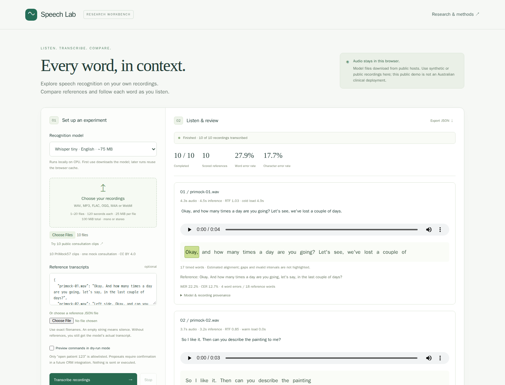

# Execution evidence and reproducibility

Measured on **2026-10-30** in Linux Chromium, CPU WASM, q8, one inference worker
and one WASM thread. Container memory limit was 2.92 GiB; models and browsers were
run sequentially. No GPU, API account or private patient recordings were used.
The exported user agent, exact start/export times, audio hashes, model revisions,
parameters and per-file observations are the authoritative records below.

## Actual speech inference

- [Ten-file tiny run](data/browser-results.json): ten complete outputs from ten
  attributed PriMock57 doctor utterances, **40.94 seconds** of audio total.
- Micro WER **41 / 147 = 27.9%**; micro CER **103 / 583 = 17.7%**. Normalization
  and missing/blank reference policy are specified in [evaluation](evaluation.md).
- This CPU run takes several seconds per clip, exceeding the one-second target.
  Exact cold-load and inference measurements are in every result's `timing` field.
  RTF across clips is below one in this environment; that does not establish
  subsecond token delivery, streaming latency or performance on another device.
- [Base model, one recording without reference](data/browser-base-result.json):
  actual nonempty hypothesis and word timestamps; accuracy is deliberately
  `null`. This is a functionality check, not a paired tiny-vs-base accuracy study.
- [Network observation](data/browser-network.json): recorded browser requests were
  GET/HEAD asset fetches, with no page exceptions. Query strings are removed to
  avoid storing expiring public CDN signatures. This supports no-upload behavior
  for the exercised path; it is not a formal proof of third-party code behavior.
- [Associative provenance](data/browser-provenance.lino) is generated from that
  actual tiny run using the installed Links Notation implementation.

The ten clips come from **one mock consultation**, are short, English, and were
selected for bounded demonstration. They are not independent patient encounters,
not an Australian clinical dataset and not a medical safety validation. Do not
rank production engines or buy microphones from these results. Errors include
ordinary phrase substitutions and changed symptom words; inspect raw output
against the human reference before deriving a clinical note. Word timing is
approximate; zero-length, overlapping or out-of-duration intervals are omitted
from highlighting without deleting words from the raw transcript.



[Mobile screenshot](../../screenshots/speech-lab/mobile.png): Playwright MCP checked
the 390 × 844 layout with no horizontal overflow; controls remained visible.

## Acceptance checks

Native tests were run red first (`ci-logs/issue-1-red.log` and
`issue-1-provenance-red.log`, local ignored logs), then implemented and validated.
These assertions remain in the repository:

| Layer                | Evidence and assertions                                                                                                                                                                                                                                                                                  |
| -------------------- | -------------------------------------------------------------------------------------------------------------------------------------------------------------------------------------------------------------------------------------------------------------------------------------------------------- |
| Native JS            | `tests/speech.test.js`: medical-number/negation edits, exact WER/CER counts, blank vs missing reference, micro aggregation, unsafe/duplicate/escaped filenames, file/total-byte bounds, timestamp gaps/overlap/invalid values, command refusals and sequential error/cancellation behavior.              |
| Graph interchange    | `tests/speech-provenance.test.js`: actual upstream parser preserves source hash, exact model revision, word span relationship and quoted Unicode raw text; rejects unknown schema.                                                                                                                       |
| Browser contracts    | `examples/speech-lab/tests/workbench.pw.js`: explicit mocked worker isolates ten-file UI contracts, partial references, raw output, active playback and seek/gap behavior, export provenance, clear, bad input, decode failure continuation and active stop. These outputs are not ASR quality evidence. |
| Actual browser model | `real-model.pw.js`: no mock routes; two real pinned models, ten complete sample results, one unreferenced base output, timestamps, export, screenshot, no non-GET/HEAD requests and no page exceptions. Five-minute file deadline and ten-minute integration test bound.                                 |
| Delivery             | Production Vite build; native suite runs before browser adapters in CI. Browser/model acceptance job is included in the release workflow's terminal status gate and both publishing prerequisites. New lockfile receives the same high-severity audit as existing packages.                              |

The native suite runs under Node, Bun and Deno. Full root lint/format/duplication,
documentation requirements, JavaScript syntax, file limits, changeset/version,
workflow and secret checks apply in addition to focused tests. CI results and the
exact tested revision remain visible on [PR #2](https://github.com/konard/medical-speech-to-text/pull/2).
Local detailed logs are saved in ignored `ci-logs/`; generated downloads and model
caches are not committed.

## Reproduce

From the repository root:

```sh
npm ci
npm test
npm run check
python3 experiments/issue-1/prepare-demo-data.py
npm ci --prefix examples/speech-lab
npm --prefix examples/speech-lab run build
cd examples/speech-lab
npx playwright install chromium
npm run test:browser
npm run test:model
```

The data script downloads pinned public sources, checks original checksums and
recreates the exact crop frames. Model testing needs internet for pinned code,
tokenizers and weights; no credentials. Use `CHROME_PATH` for a preinstalled
compatible Chromium. All model runs are sequential. No real-time/subsecond or
clinical accuracy assertion has been weakened to make the browser tests pass;
they test actual functioning, while the research plan defines the performance
and clinical acceptance experiments still to run on the intended deployment.

## Scope of verified access

Verified: public Whisper tiny/base weights, local browser execution, references,
playback highlighting, export and reproducible public sample data.

Not executed: paid API entitlements, Sydney GPU quota, cloud streaming/CRM writes,
AU production infrastructure, physical microphone experiments, private-data
collection, clinical trials or model training. These are explicitly specified
future study/delivery stages in the issue's requested plan, not delivered backend
features. This PR does not represent a completed clinical deployment or silently
defer a requested functioning demo. Current product locality/access findings are
documented in [solutions](solutions.md) and [architecture](architecture.md).
