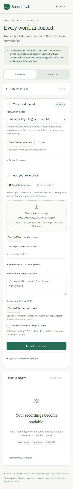

# Mobile and on-device speech lab: issue 3

Research date: **30 October 2026**. [Issue 3](https://github.com/konard/medical-speech-to-text/issues/3)
requests a mobile-first React demo, browser chat and transcription informed by
Google AI Edge Gallery, an audit of issue 1, and investigation of failed main CI.
The complete request, prior issue, prior PR and research inputs are preserved in
[data](data/). Issues 1 and 3 have no comments or required sub-issues; PR 4 had no
conversation, inline feedback or reviews at the initial inventory.

An unrelated template case study previously occupied this directory; its complete
text is preserved in [the release-formatting archive](template-release-formatting.md)
and its original `issue-data.json` remains in place.

[Open the updated demo](https://raw.githack.com/konard/medical-speech-to-text/issue-3-60721261c8eb/examples/speech-lab/index.html).
The source host may require selecting **Open the page** before loading the app.
Use public or synthetic data. This public demonstration loads global code/model
assets; it is not an Australian clinical deployment.

| Question                                                 | Read                                                  |
| -------------------------------------------------------- | ----------------------------------------------------- |
| What covers every requirement, including issue 1?        | [Acceptance and audit](requirements.md)               |
| Which Gallery patterns, libraries and devices apply?     | [Browser research and decisions](browser-research.md) |
| How can an optional service compare quality?             | [Quality comparison protocol](quality-service.md)     |
| Which main failures were real, and what remains blocked? | [CI investigation](ci-investigation.md)               |
| What actually ran, with what limitations?                | [Verification and adapter inventory](verification.md) |
| Where are current facts sourced?                         | [Dated primary sources](sources.md)                   |

The demo uses React 19.2.0, pinned Transformers.js 3.8.1 and immutable ONNX model
revisions. CPU/WASM is the portable baseline. Whisper tiny/base provide actual
English transcription, reference WER/CER, word playback and provenance exports.
SmolLM2-135M-Instruct q4 provides a separate local chat experiment. It is a small
general English model, unsuitable for medical advice or autonomous CRM actions.
The model download is approximately **182 MB decimal for q4 weights alone**;
tokenizer/configuration/runtime bytes and loaded memory are additional.

A user can explicitly prepare/unload a model, stop work, inspect/delete this
demo's cached model entries, record up to 60 seconds, clear chat, or compare an
individual recording with an approved HTTPS service. Chat never silently consumes
transcripts. No service endpoint or credentials are bundled. Network downloads,
interim text, first-use delays and unsupported capabilities remain visible.
Cache presence is not a promise of complete offline availability.

The [issue 1 plan](../issue-1/README.md) remains the detailed production research
protocol: Australian AWS hosting, clinical datasets, microphone crossover,
20-engine comparison, CRM confirmation, fine-tuning and lifecycle gates. This PR
audits that plan and expands its device/browser layer. It does not mislabel a
future clinical pilot, procurement or private cloud deployment as an execution.
The dependency graph prerequisite has been enabled and verified. Main's npm
release setup still requires package/account credentials; [that acceptance
remains explicitly unfinished](ci-investigation.md).
