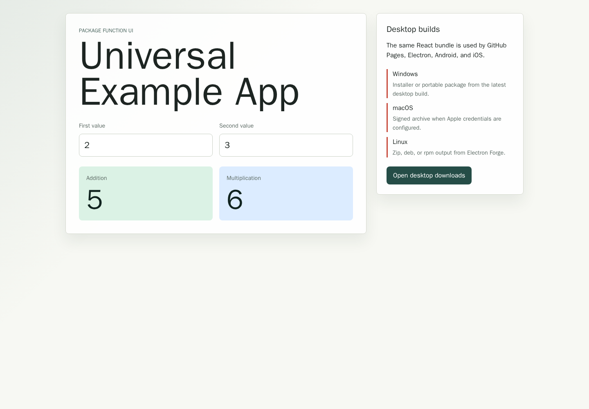
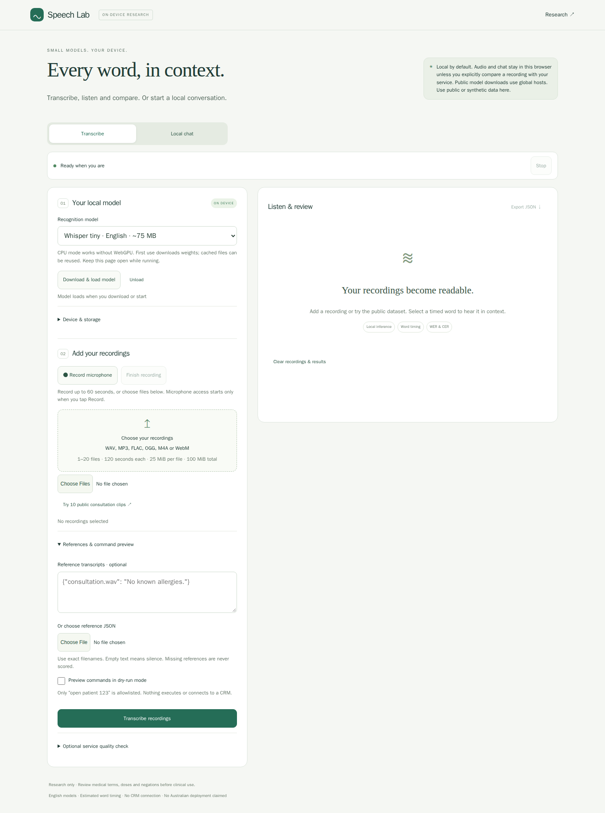

# Issue 7: useful speech demo and current dictation research

Issue: [7](https://github.com/konard/medical-speech-to-text/issues/7).
Implementation: [PR 8](https://github.com/konard/medical-speech-to-text/pull/8).
Research retrieved 31 October 2026 UTC. This case study extends the
[original medical research plan](../issue-1/README.md) and
[mobile/local-model audit](../issue-3/README.md).

The public Pages URL returned **Universal Example App**, a calculator, on
31 October. Pages itself was enabled and its latest deployment succeeded. The
wrong build directory was selected. This PR makes the existing medical speech
lab the root page, tests the production bundle at the repository subpath and
preserves the separate calculator/desktop/mobile examples. It adds a pinned
Whisper Flow review, a current alternatives shortlist and a measurable plan to
match or exceed Wispr Flow for the original medical workflow.

- [Every requirement and its acceptance evidence](requirements.md)
- [Timeline, root causes and CI evidence](investigation.md)
- [Whisper Flow and missing options](alternatives.md)
- [Quality/service implementation and evaluation plan](service-plan.md)
- [Validation and rollout status](verification.md)
- [Primary-source register](sources.md)

The after image is the locally served **production artifact**, not evidence of
a live production rollout. Main-only deployment protections remain in force.
[Verification](verification.md) separates tested behavior from external blockers.
No new production ASR service, physical-device benchmark or measured victory over
Wispr Flow is claimed. Issue 7 asks what is needed to reach that quality; the
protocol defines how to establish it rather than treating a feature list as proof.
